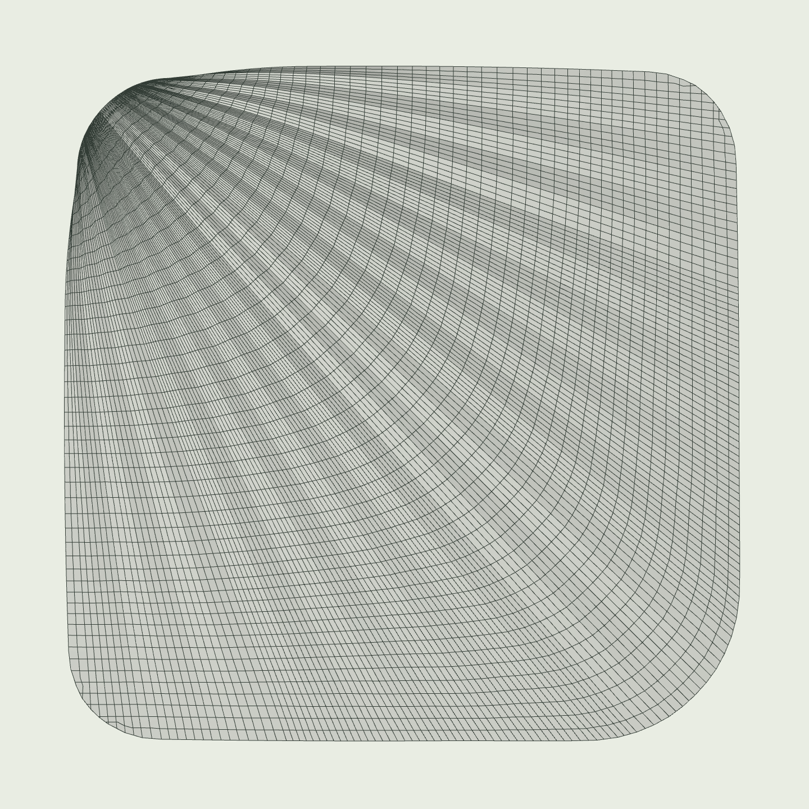

# 1102e 屋面铝板 · V3 放射随形排列

按本轮两张参考图，将分隔方向改为**角部放射长向接缝 + 横向随形弧带**。沿原屋面恢复的导向网格细分，保持原三维曲面。

## 下载

- [完整离线网页（约6.7 MB）](https://github.com/liuzuguo/-/raw/refs/heads/roof-panels-v3/roof-panels-v3/roof_panels_radial_v3.html)：下载保存为HTML，用新版Edge或Chrome打开。
- [轻量网页包（约5.0 MB）](https://github.com/liuzuguo/-/raw/refs/heads/roof-panels-v3/roof-panels-v3/roof_panels_radial_v3_web.zip)：解压后打开根目录 **app.html**，含模型、统计与SketchUp脚本下载。
- [完整成果包（约20.6 MB）](https://github.com/liuzuguo/-/raw/refs/heads/roof-panels-v3/roof-panels-v3/roof_panels_radial_v3_full.zip)：含新排列JSON/DAE模型、全部CSV统计、模型示意、桥接脚本及复算资料。
- [高清单屋顶排列顶视图](https://github.com/liuzuguo/-/raw/refs/heads/roof-panels-v3/roof-panels-v3/roof_panels_radial_v3_top.png) · [四组屋顶三维图](https://github.com/liuzuguo/-/raw/refs/heads/roof-panels-v3/roof-panels-v3/roof_panels_radial_v3_axo.png)

点击网页的 **单屋顶顶视**，即可直接对照参考图。默认铝板原色、深色接缝；支持按板型、屋顶和待深化小板着色。

## 默认方案统计

| 项目 | 数值 |
| --- | ---: |
| 铝板总数 | 29,608块 |
| 几何板型（区分曲面镜像左右手） | 7,205类 |
| 尺寸管理组（毫米向上取整） | 2,061组 |
| 表面净面积 | 41,612.70 m² |
| 最大保守宽度 | 1,461.465 mm |
| 最大保守长度 | 2,999.999 mm |
| 小于0.05m²的待深化小板 | 512块 |

另有连续放射1200×3000、1500×2400分带基准供对比；基准不代表每块成品尺寸完全相同。优先保持参考图的连续放射排列，不声称所有模数的全局最优。

## 模型与校核

- 原始1027EX屋面已由用户确认与1102e一致；只重做分隔，不改变原屋面造型。
- 三套候选通过独立校核：表面积守恒、覆盖/重叠、原曲面来源、随形曲线方向、折线切分、平面外包络及尺寸限制。
- 曲面板尺寸是三维路径上界；平面板另核1.5×3米矩形。曲面路径尺寸不是平板加工展开尺寸。
- 本方案未扣板缝，未计折边、板厚、龙骨、搭接与成形工艺；边缘小板仍需收边深化。
- 已验证真实浏览器中的模型点选、分区统计、方案保存、CSV/JSON/DAE下载；所有入口HTML内嵌完整数据，无外部资源依赖。
- SketchUp桥接默认独立图层 **RP_V3屋面铝板_放射随形**，可隐藏V2旧分隔后查看新方案。云端未连接或直接修改用户电脑的SKP，也未实测SketchUp2018内运行，导入前请另存副本核对。

[详细说明](先读我.md) · [文件SHA-256](checksums.json) · [V2旧版](https://github.com/liuzuguo/-/tree/roof-panels-v2/roof-panels)
