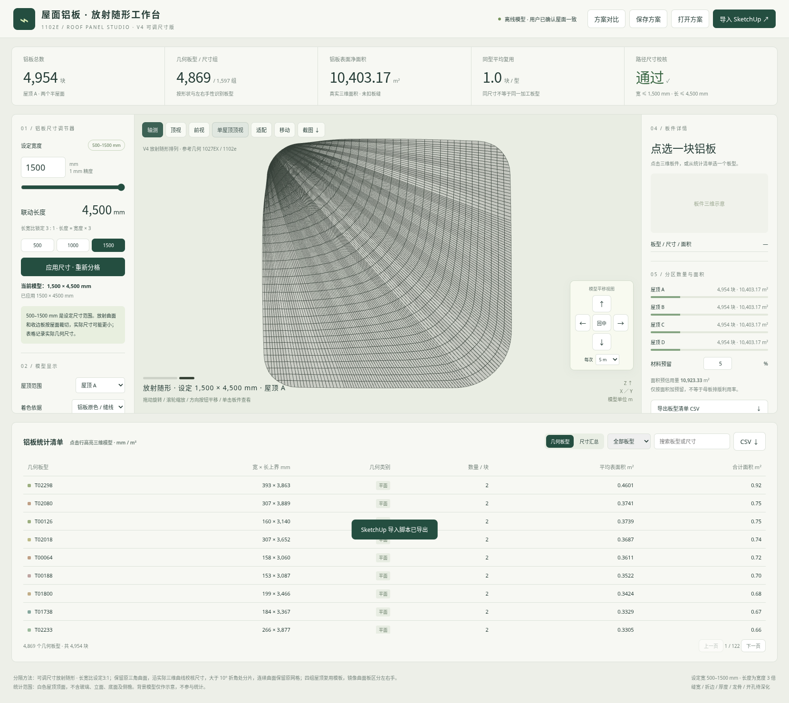

# 1102e 屋面铝板 V4 · 自由尺寸与模型平移

在放射随形排列上增加真实离线尺寸计算和模型平移按钮。无需安装依赖，下载后用新版Edge或Chrome打开。

## 下载

- [交互网页包（约3.2 MB）](https://github.com/liuzuguo/-/raw/refs/heads/roof-panels-v3/roof-panels-v4/roof_panels_adjustable_v4_web.zip)：解压后打开根目录 **app.html**。
- [单文件完整网页（约4.4 MB）](https://github.com/liuzuguo/-/raw/refs/heads/roof-panels-v3/roof-panels-v4/roof_panels_adjustable_v4.html)：下载为HTML后直接打开。
- [完整系统包（约12.7 MB）](https://github.com/liuzuguo/-/raw/refs/heads/roof-panels-v3/roof-panels-v4/roof_panels_adjustable_v4_full.zip)：含网页、桥接脚本、源码/复算报告及1500×4500mm导出示例。
- [界面预览](https://github.com/liuzuguo/-/raw/refs/heads/roof-panels-v3/roof-panels-v4/roof_panels_adjustable_v4_preview.png)

## 新增功能

1. **宽度500–1500mm自由调节**：数字输入或滑块，1mm精度；三个快捷按钮只是便捷入口，并非仅三个预设。
2. **长度自动等于宽度3倍**：例如873×2619mm、1500×4500mm。最大长度4500mm按最新要求实现，替代旧3000mm上限。
3. **实际重新分格**：每次应用重新计算放射随形板件、数量、几何尺寸、统计和导出；原屋面造型保持不变。
4. **模型移动按钮**：上/下/左/右、点击或长按、1/5/10m步长、回中；模型获得焦点后方向键可平移。只改变查看位置，不改变导出坐标。
5. **完整保存/导出**：保存V4自定义尺寸方案；CSV、JSON、DAE使用当前已应用的尺寸及屋顶范围，支持新的4500mm上限。

默认1000×3000mm。真实重算结果：

| 设定宽×长 mm | 全屋面板数 |
| --- | ---: |
| 500×1500 | 156,448 |
| 873×2619 | 55,216 |
| 1000×3000 | 41,336 |
| 1500×4500 | 19,816 |

原屋面总净面积约41,612.70m²，尺寸变化只改变分格数量。

## 尺寸口径

**500–1500mm是设定宽度范围，放射收分与边缘裁切板的实际宽度可能小于500mm；实际异形板比例也可能不同于设定3:1。** 实际尺寸见统计表。曲面尺寸为三维路径上界，未计算平板加工展开、板缝、折边、厚度、龙骨和成形工艺。

500、873、1000、1500mm及其他非预设宽度已通过独立几何校核。浏览器验证了快速修改、16万板量级点选、按钮平移、保存/恢复和新尺寸CSV/JSON/DAE导出。SketchUp桥接已做语法和数值预检，但未在SketchUp2018内实测；默认新图层为RP_V4可调铝板_放射随形，现有模型不自动删除。

[详细说明](使用说明.md) · [文件校验](checksums.json) · [保留的V3固定版](../roof-panels-v3/README.md)
