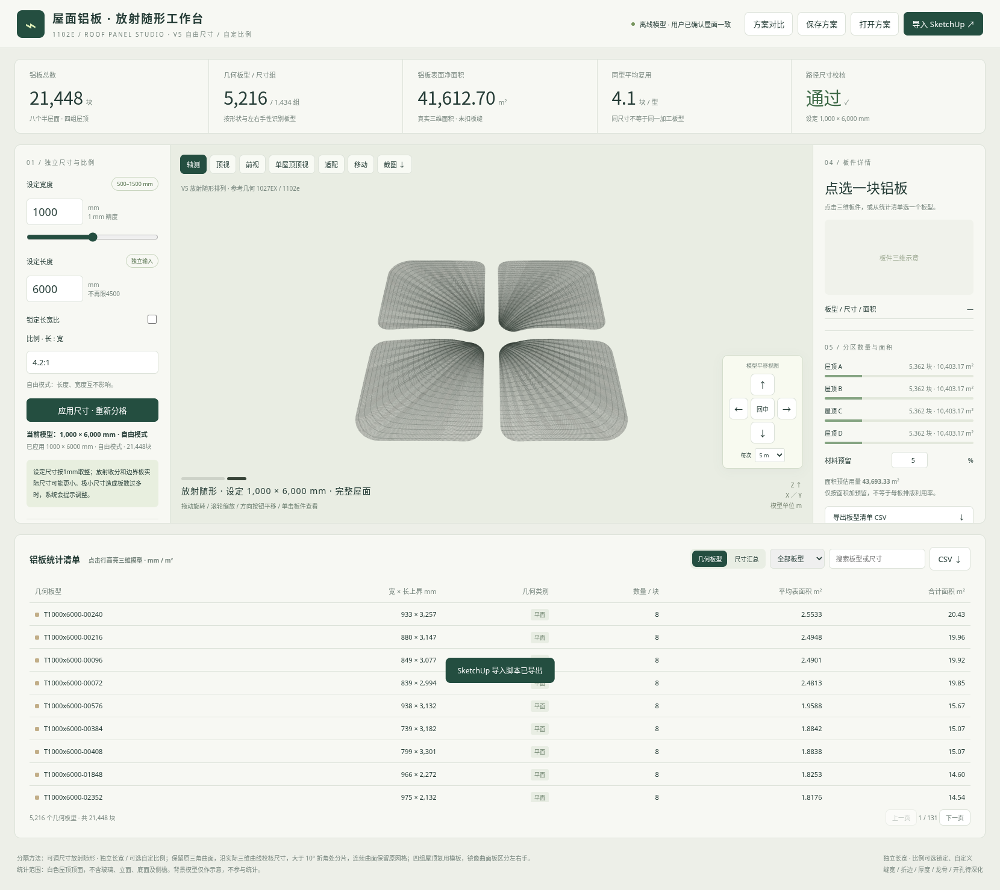

# 1102e 屋面铝板 V5 · 独立长宽与可选自定比例

取消固定3:1。默认宽度、长度独立输入；需要约束时勾选比例锁，输入任意正的长宽比。保留原放射随形造型、移动按钮、统计及模型导出。

## 下载

- [新版交互网页包（约3.3 MB）](https://github.com/liuzuguo/-/raw/refs/heads/roof-panels-v3/roof-panels-v5/roof_panels_flexible_v5_web.zip)：解压后打开根目录 **app.html**。
- [单文件完整网页（约4.5 MB）](https://github.com/liuzuguo/-/raw/refs/heads/roof-panels-v3/roof-panels-v5/roof_panels_flexible_v5.html)：下载后用新版Edge或Chrome打开。
- [完整系统包（约14.1 MB）](https://github.com/liuzuguo/-/raw/refs/heads/roof-panels-v3/roof-panels-v5/roof_panels_flexible_v5_full.zip)：含源码、复算报告、桥接及1000×6000mm自由模式导出示例。
- [独立尺寸预览](https://github.com/liuzuguo/-/raw/refs/heads/roof-panels-v3/roof-panels-v5/roof_panels_flexible_v5_preview.png) · [自定义比例预览](https://github.com/liuzuguo/-/raw/refs/heads/roof-panels-v3/roof-panels-v5/roof_panels_flexible_v5_ratio.png)

## 使用

- **自由模式**：比例锁默认关闭，长宽分别输入，互不带动。长度不再限4500mm；宽度保留此前500–1500mm范围，设定按1mm精度。
- **自定比例**：勾选“锁定长宽比”，先保留当前比例。随后可输入 `2.5`、`5:2`、`4:5` 等正比例（长÷宽）；改宽联动长，改长联动宽。
- **取消勾选**恢复独立模式。长度小于宽度也可输入，例如1200×800；系统保持输入的两方向，统计则按实际几何短/长边列出。
- **应用尺寸**后真实重新分格、统计、保存及导出。同宽不同长是不同方案，不会错误复用缓存；快速修改只应用最新结果。
- 保留模型平移、长按、步长及回中；移动只改变视图，不改变导出坐标。

## 校核

500×1500、1000×6000、873×2222、1200×800、1000×4200（比例4.2）均通过独立几何校核。原曲面、每个源三角面覆盖、方向尺寸、矩形包络、折线、实例面积及数量均已复算，原净表面积约41,612.70m²。浏览器验证了自由输入、比例双向联动、保存恢复、JSON/CSV/DAE、点选、移动和离线运行。SketchUp桥接兼容V3/V4，支持V5自由/比例模式，语法和实际世界坐标导出数值预检通过；未在SketchUp2018实机运行。

设定尺寸/比例不是每块曲面或边界裁切板的最终下料尺寸。边缘板实际可能更窄；板缝、折边、厚度、龙骨与曲面成形仍需深化。极小尺寸预计超过50万板时会提示，保留上一次成功模型。

[详细说明](使用说明.md) · [校验文件](checksums.json) · [保留V4](../roof-panels-v4/README.md)
