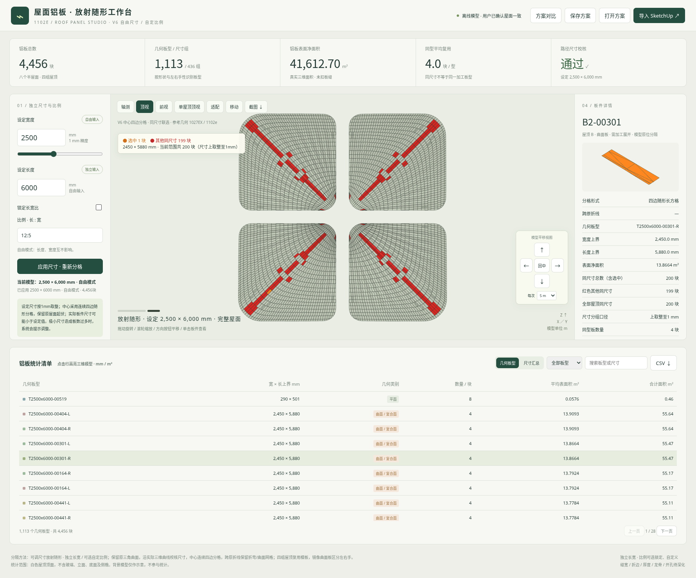

# 1102e 屋面铝板 V6

取消1500mm宽度限制，长宽自由输入，可选自定义比例。点选板橘色，其余同尺寸板红色，同时显示数量。中心改为连续四边随形分格，保留原屋面起伏和外轮廓。

## 下载

- [新版交互网页包](https://github.com/liuzuguo/-/raw/refs/heads/roof-panels-v3/roof-panels-v6/roof_panels_flexible_v6_web.zip)：解压后打开根目录 **app.html**。
- [单文件离线网页](https://github.com/liuzuguo/-/raw/refs/heads/roof-panels-v3/roof-panels-v6/roof_panels_flexible_v6.html)：下载后用新版Edge或Chrome打开。
- [完整成果包](https://github.com/liuzuguo/-/raw/refs/heads/roof-panels-v3/roof-panels-v6/roof_panels_flexible_v6_full.zip)：含源码、校核报告、SketchUp桥接及2500×6000mm导出示例。
- [同尺寸联选预览](roof_panels_flexible_v6_preview.png) · [中心四边分格预览](roof_panels_flexible_v6_center.png) · [自定义比例预览](roof_panels_flexible_v6_ratio.png)

## 使用

1. 宽度和长度分别输入正数，按1mm取整；取消原500–1500mm范围。例如2500×6000、5000×3000、400×6000均可。
2. 需要联动时勾选“锁定长宽比”，输入 `2.5`、`5:2` 或 `4:5` 等比例，表示长度÷宽度，支持双向联动。
3. 点击“应用尺寸”后，模型、统计和导出按新尺寸真实重算。
4. 点选板件：橘色为选中板，红色为其他同尺寸板。角标和详情显示当前范围的同尺寸总数及其他板数；详情另列全部屋顶总数。
5. 保留移动按钮、长按、步长、回中、保存和CSV/JSON/DAE导出。

同尺寸使用实际短边/长边上界，上取整至1mm分组，可包含不同几何板型和左右镜像板；不是按设定名义尺寸代替实际尺寸。

## 中心分格

向中心采用连续四边的曲面长方格，原三角面和斜折线保留在曲面/折弯板内部。横带分别调整条数，向收拢端减少窄条，横带间允许T形错缝。

默认1000×3000mm：全屋面20,584块，其中20,472块完整四边随形分格、112块原外轮廓修边。中心内部408/408块均为完整四边格。四边格保持曲面起伏，不表示平直下料长方形；真实外沿和角部仍须修边，界面、CSV和JSON均明确区分。

原曲面覆盖、无重叠、XYZ来源、尺寸和8个实例面积已独立校核，净面积约41,612.70m²。浏览器实测了大于1500mm宽度、比例联动、橘红像素与数量、保存恢复、移动及导出。桥接已做语法和数值预检，未在SketchUp2018实机运行。

[详细使用说明](使用说明.md) · [校验文件](checksums.json) · [保留V5](../roof-panels-v5/README.md)
