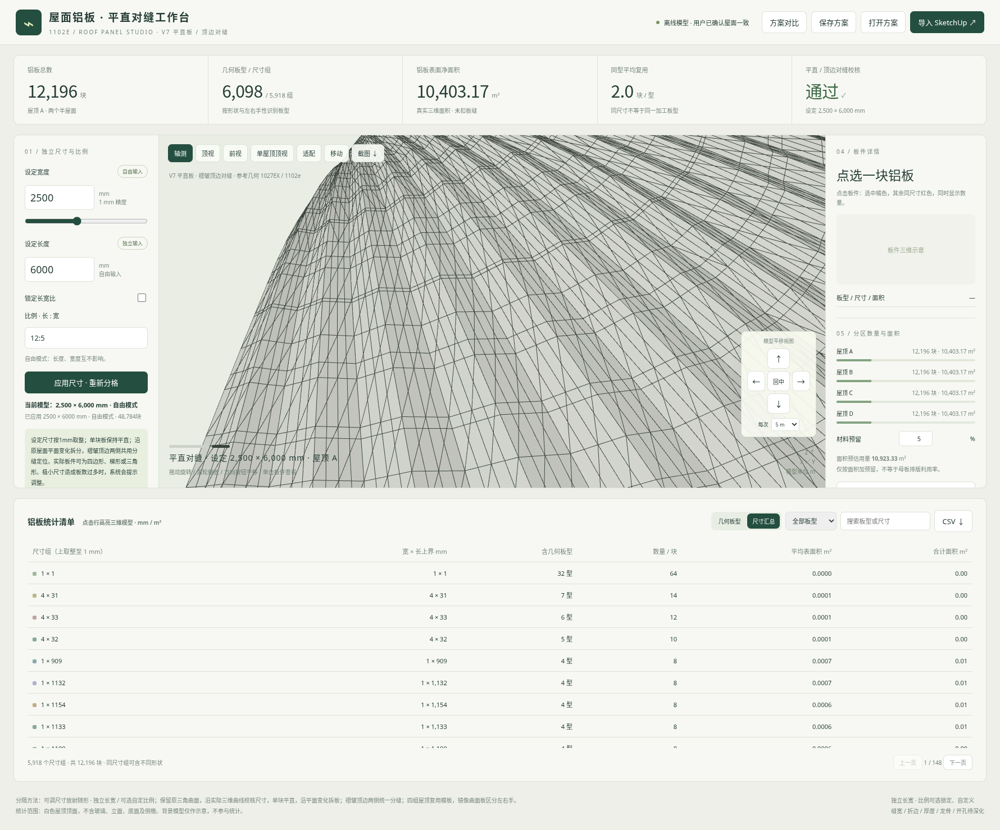

# 1102e 屋面铝板 V7 · 平直板与褶皱顶边对缝

本次仅修改两项：每块铝板保持平直、不跨折线折弯；褶皱顶边两侧统一定位，分缝对齐。保留自由尺寸、自定义比例、橘红同尺寸联选、移动和统计导出。

## 下载

- [新版交互网页包](https://github.com/liuzuguo/-/raw/refs/heads/roof-panels-v3/roof-panels-v7/roof_panels_planar_v7_web.zip)：解压后用新版Edge或Chrome打开 **app.html**。
- [单文件离线网页](https://github.com/liuzuguo/-/raw/refs/heads/roof-panels-v3/roof-panels-v7/roof_panels_planar_v7.html)：下载后直接打开。
- [完整成果包](https://github.com/liuzuguo/-/raw/refs/heads/roof-panels-v3/roof-panels-v7/roof_panels_planar_v7_full.zip)：含源码、校核报告、SketchUp桥接及2500×6000mm实际导出。
- [平直板预览](roof_panels_planar_v7_preview.png) · [顶边对缝近景](roof_panels_planar_v7_ridge.png) · [同尺寸联选预览](roof_panels_planar_v7_selection.png)

## 平直与对缝规则

沿原模型实际平面变化拆板，所有实际顶点必须满足0.0001mm平面数值容差。网页应用和V7桥接都检查实际坐标；弯折的板不会因为标签写“平面”而被接受。

原屋面起伏、坐标和外轮廓保持。原四边网格并非都共面，因此不能全部合并成长方形平板；必要的梯形、三角形或多边形平板保留并明确分类。V7不再沿用V6的跨折线曲面板合并方式。

所有板使用统一U/V定位；尺寸需要细分时全局同步，430条模板褶皱边两侧的真正换板位置全部对齐。独立校核从实际XYZ坐标重建分缝，未以添加共线点代替对缝。

默认1000×3000mm：107,792块，全部平直，弯折板0、顶边错缝0。完整包2500×6000mm示例：48,784块，JSON和DAE均通过实际共面性检查。原净面积约41,612.70m²。严格平面拆分比V6合并曲面板产生更多板件，统计按新规则重算。

## 保留功能

长宽独立输入，宽度不受1500mm上限限制；可选比例锁，输入2.5、5:2等比例并双向联动。点选橘色板、其余同尺寸红色，显示当前范围总数及其他板数量；尺寸按实际短/长边上界上取整到1mm分组。保留模型移动、长按、步长、回中、保存和CSV/JSON/DAE导出。

保存V7参数，也可打开V5/V6参数后按V7重新计算。导入SketchUp时使用新图层 `RP_V7平直铝板_顶边对缝`；请隐藏旧版分隔图层单独检查V7，原模型及旧分隔不会自动删除。桥接已作语法和数值预检，未在SketchUp2018实机运行。

尚未计入板缝、折边、板厚、龙骨及开孔，仍需加工深化。

[详细使用说明](使用说明.md) · [文件校验](checksums.json) · [保留V6](../roof-panels-v6/README.md)
