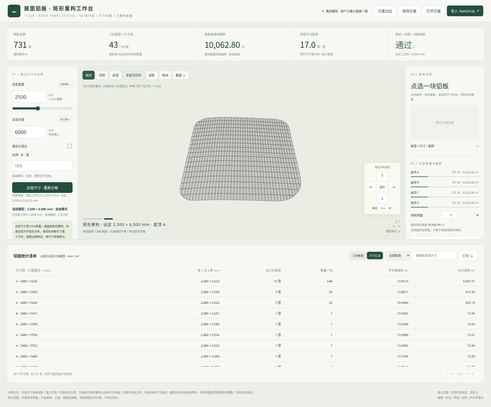

# 1102e 屋面铝板 V8 · 矩形模数与尺寸均衡

已按用户授权重构屋面，优先保证实际长方形板和标准邻板尺寸接近。原放射褶皱改为直线平行折面，原建筑位置与模型作为参考。

## 下载

- [新版交互网页包](https://github.com/liuzuguo/-/raw/refs/heads/roof-panels-v3/roof-panels-v8/roof_panels_rectangular_v8_web.zip)：解压后用新版Edge或Chrome打开 **app.html**。
- [单文件离线网页](https://github.com/liuzuguo/-/raw/refs/heads/roof-panels-v3/roof-panels-v8/roof_panels_rectangular_v8.html)：下载后直接打开。
- [完整成果包](https://github.com/liuzuguo/-/raw/refs/heads/roof-panels-v3/roof-panels-v8/roof_panels_rectangular_v8_full.zip)：包含源码、校核报告、SketchUp桥接及2500×6000mm实际导出示例。
- [矩形分格预览](roof_panels_rectangular_v8_preview.png) · [圆弧修边近景](roof_panels_rectangular_v8_arc.png) · [同尺寸联选预览](roof_panels_rectangular_v8_selection.png)

## 设计规则

内部板件为实际平直长方形：四直角、对边平行等长、全部顶点共面。只有与真实外圆弧接触的修边板可为异形；内部原三角面和原折线均不作外沿例外。

标准矩形采用统一模数，全局排缝对齐，内部相邻板的实际短/长边尺寸差≤10%。圆弧边缘从同一模数板裁切，净尺寸单独统计，裁切后的净尺寸不纳入内部邻板均衡指标。

默认输入1000×3000mm：14,204块，其中内部矩形13,836块、外圆弧修边368块；内部邻板最大尺寸差约0.90%，顶边错缝0处。五组尺寸的最大内部邻板差约3.49%，均低于10%。同规格矩形归并为同一板型。

默认新净面积约40,298.01m²，原参考约41,612.70m²；默认最大高度变化约5.224m、均方根约1.341m。其他尺寸重新计算，形态及变化数值随之更新，不能视为原屋面的原位分隔。

完整包2500×6000mm示例：2924块=2764块矩形+160块弧边修边，内部邻板差约0.59%，净面积约40,251.21m²，最大高度变化约5.246m。背景建筑仍为原模型，仅供位置参考。

## 保留的交互

长宽自由输入，宽度不受1500mm上限限制；可选任意正的长宽比联动。实际模数在输入区显示。点选板橘色，其他同净尺寸板红色并显示数量；保留移动、长按、步长、回中、保存及CSV/JSON/DAE导出。

SketchUp导入新图层为 `RP_V8矩形铝板_重构屋面`。隐藏原屋面和旧分隔后查看重构结果，原模型不会自动删除。桥接已做语法和逐板数值预检，未在SketchUp2018实机运行。板缝、板厚、支承、龙骨及开孔仍需深化。

[使用说明](使用说明.md) · [文件校验](checksums.json) · [交付校核](delivery_validation_v8.json) · [保留V7](../roof-panels-v7/README.md)
