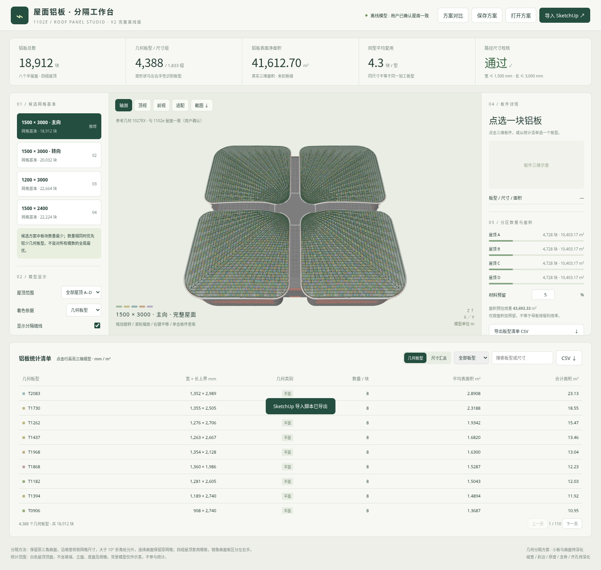

# 1102e 屋面铝板分隔工作台 · V2修复版

## 下载到电脑桌面

- [完整离线网页（约5.2 MB）](https://github.com/liuzuguo/-/raw/refs/heads/roof-panels-v2/roof-panels/roof_panels_fixed_v2.html)：下载后保存到桌面，用新版Edge或Chrome打开。
- [轻量网页包（约3.9 MB）](https://github.com/liuzuguo/-/raw/refs/heads/roof-panels-v2/roof-panels/roof_panels_web_v2.zip)：含完整网页及SketchUp桥接脚本；解压后打开根目录app.html。
- [完整成果包（约14.6 MB）](https://github.com/liuzuguo/-/raw/refs/heads/roof-panels-v2/roof-panels/roof_panels_fixed_v2.zip)：含网页、JSON/DAE模型、CSV统计、模型示意及复算资料。

网页如果在浏览器显示源码，请使用“另存为”，文件名保留.html。文件页面右上角的“Download raw file”也可下载。

## 修复内容

此前误打开开发模板app.html会缺少内嵌模型数据并报null.textContent。V2的全部HTML入口都已内嵌模型、方案、建筑背景及SketchUp导入脚本。开发模板改为.txt后缀，不再混入可运行HTML。没有外部脚本、字体或模型网络依赖。

模型与统计已从实际解压文件复验：18,912块铝板，41,612.70m²。支持旋转缩放、点选板件、四个候选方案、按屋顶筛选、尺寸汇总、小板高亮、方案保存/打开，以及CSV、JSON、DAE导出。网页“导入SketchUp”内可直接下载桥接脚本。

## 使用与统计口径

依据所上传1027EX编辑器内嵌原始屋面，用户确认与1102e屋面一致。保留原造型；未直接连接、修改或保存用户电脑上的SKP。完整包内有SketchUp2018导入说明；桥接新增可撤销的独立分组，保留原模型，需在模型副本中核对后另存。

- 几何板型4,388类（区分曲面镜像左右手）；尺寸管理组1,833组（上取整至1毫米）。
- 四个候选内优先总块数最少，不代表所有分隔模数的全局最优。
- 曲面板尺寸是保守表面路径上界；平面板另校核1.5×3米正交矩形。曲面路径上界不是加工展开尺寸。
- 440块小于0.05m²的边缘小板需继续深化收边；未计算板厚、折边、缝宽、龙骨及成形工艺。
- 几何及浏览器功能检查通过；云端无SketchUp，未实测SketchUp2018内运行。

[详细说明](先读我.md) · [SketchUp桥接脚本](sketchup_bridge.rb) · [文件SHA-256](checksums.json)

本次内容已获用户同意上传到此仓库；仓库访问者可查看成果和模型数据。
